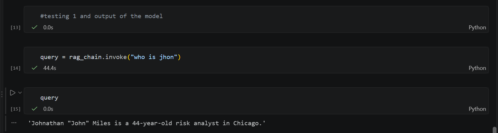
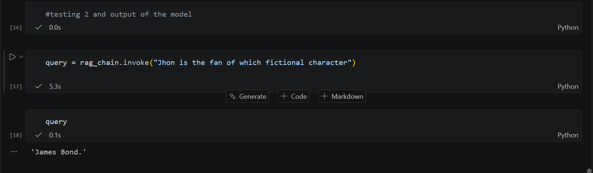

# Local RAG Application with Ollama

A fully local Retrieval-Augmented Generation (RAG) application built with Python, LangChain, and Ollama. This project is designed to query custom text documents securely, running entirely on the local machine without the need for paid API keys or external cloud dependencies.

# Tech Stack
- Framework: LangChain
- LLM: Ollama (Llama 3.2)
- Vector Database: ChromaDB
- Embeddings: HuggingFace (Sentence Transformers)

# How to Run Locally

1. Install Ollama: Download and install it from https://ollama.com/
2. Download the Model: Open your terminal and run:
   ollama run llama3.2
3. Set up the environment:
   python -m venv venv
   venv\Scripts\activate
4. Install dependencies:
   pip install -r src/basic_rag_1/requirements.txt
5. Run the notebook: Open src/basic_rag_1/basic_rag.ipynb in VS Code or Jupyter and run the cells.

# Output Preview

# 1. Query Execution and Context Retrieval

#  2. Fictional Character Identification
